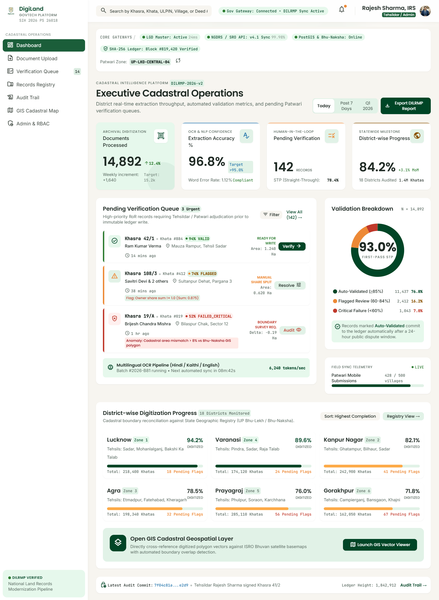
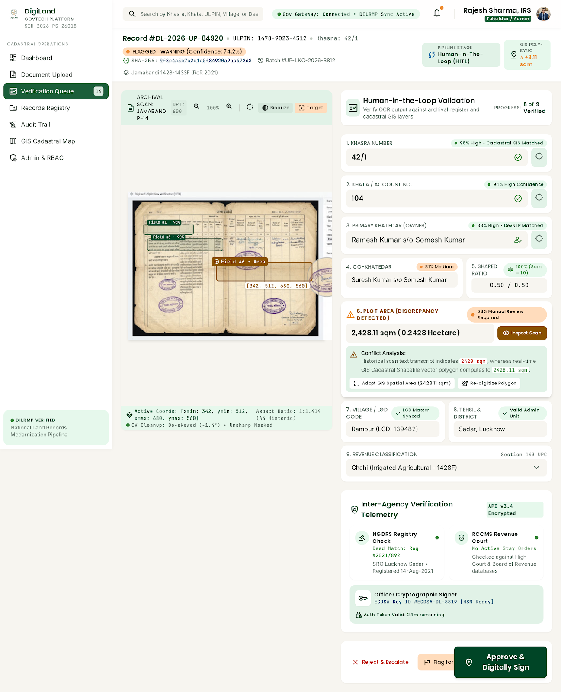
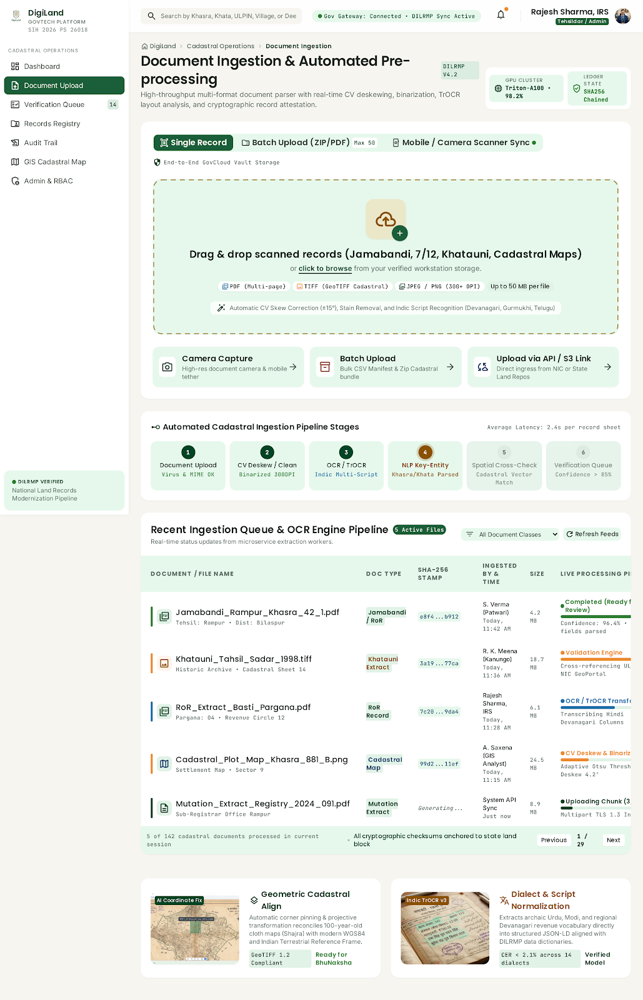
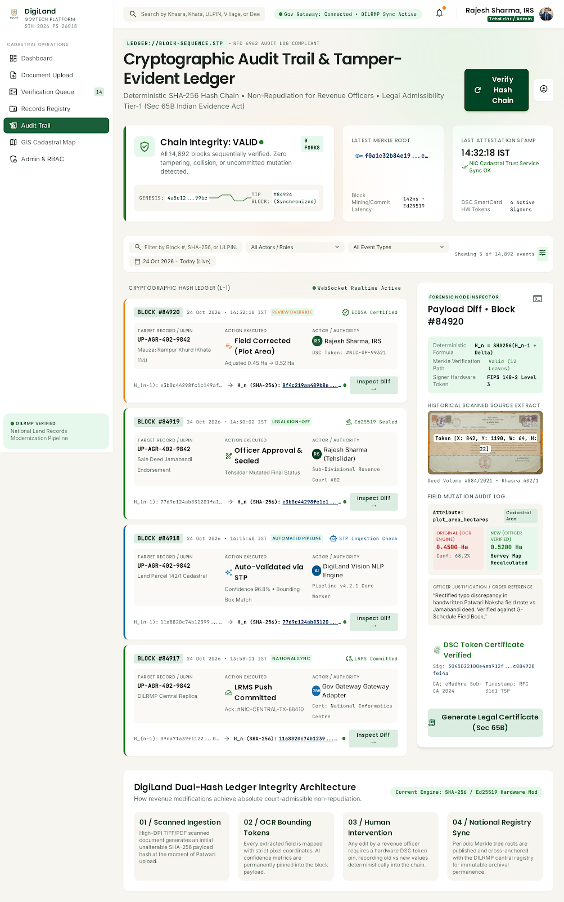

<div align="center">


<br/>


<br/><br/>


<br/><br/>

> ### 🇮🇳 End-to-End GovTech Solution for Land Record Extraction, Cross-Database Verification, Immutable Blockchain Audit Ledger & Cadastral Vector Mapping
>
> *Built for Smart India Hackathon (SIH) 2026 — Problem Statement 26018*

<br/>

[](https://pbanirudh.github.io/DigiLand/)
[](https://github.com/pbanirudh/DigiLand)

</div>

---

## 🖥️ Screenshots

<div align="center">

### 📊 Executive Dashboard
<a href="https://pbanirudh.github.io/DigiLand/">
  
</a>

<br/><br/>

### 🔍 Split-View Verification (Human-in-the-Loop)
<a href="https://pbanirudh.github.io/DigiLand/">
  
</a>

<br/><br/>

### 📄 Document Upload & OCR Pipeline
<a href="https://pbanirudh.github.io/DigiLand/">
  
</a>

<br/><br/>

### 🛡️ Cryptographic Audit Trail
<a href="https://pbanirudh.github.io/DigiLand/">
  
</a>

</div>

---

<div align="center">

## 🌟 What is DigiLand?

</div>

**DigiLand** is an enterprise-grade, state-of-the-art GovTech platform designed to **digitize, validate, deduplicate, and audit Indian land records** across diverse document formats and regional languages. Built for Revenue Department officers — Patwaris, Tehsildars, and District Collectors — under **DILRMP (Digital India Land Records Modernization Programme)** guidelines.

DigiLand tackles India's most critical land governance challenge: **fragmented, duplicate, and fraudulent land records** scattered across incompatible legacy systems, paper archives, and regional databases.

---

## 🎯 Core Problem Statement

```
┌─────────────────────────────────────────────────────────────────┐
│  💥 India has ~150 million land parcels                         │
│  ❌ 66% of civil disputes are land-related                      │
│  📄 Records exist in 10+ regional languages                     │
│  🔄 Massive duplicate & fraudulent entries in registries        │
│  🏗️ No unified, verifiable, tamper-proof digital system         │
└─────────────────────────────────────────────────────────────────┘
```

**DigiLand solves this** with a unified, AI-powered platform for intelligent OCR extraction, cross-database verification, cryptographic audit trails, and real-time GIS cadastral mapping.

---

## ✨ Feature Showcase

<table>
<tr>
<td width="50%">

### 🌐 Multilingual OCR Engine
- **10 Indian Languages** — English, Hindi, Tamil, Telugu, Marathi, Bengali, Gujarati, Kannada, Malayalam, Urdu
- PaddleOCR PP-OCRv4 powered extraction
- Native RTL (Right-to-Left) support for Urdu
- Auto document schema classification

</td>
<td width="50%">

### 🔍 Split-View Verification
- **50/50 Dual-Pane Viewport** — Field ↔ Source
- OCR Bounding Box Backtracking per field
- Full-screen zoom inspection modal
- Multi-page document stepping (`Page X of Y`)
- Native PDF & image rendering

</td>
</tr>
<tr>
<td width="50%">

### ⚡ SHA-256 Deduplication Engine
- Cryptographic + Metadata deduplication
- Real-time Duplicate Alert Modal at upload
- Side-by-side master ↔ duplicate comparison
- 1-Click **Purge All Duplicates** across registry
- Persistent purge state across sessions

</td>
<td width="50%">

### 🛡️ Immutable Blockchain Audit Ledger
- SHA-256 Block Hashing: `H_n = SHA256(H_{n-1} || Payload)`
- Ed25519 Digital Signatures per officer
- Every approval/rejection is cryptographically logged
- Tamper-evident chain with hash verification
- Full audit trail export

</td>
</tr>
<tr>
<td width="50%">

### 🗺️ Bhu-Naksha GIS Cadastral Mapping
- Leaflet-based interactive cadastral maps
- Satellite, Cadastral Parcel & Zoning layer toggles
- Spatial geometry cross-validation
- Plot area (m²) vs. GIS polygon verification
- Real-time parcel selection & record linking

</td>
<td width="50%">

### ⚖️ Revenue Invariants Engine
- Share fraction validation (Σ shares = 1.00)
- Dual Verification: **Approve** / **Reject** workflow
- Interactive Rejection Reason Modal
- RBAC — Patwari → Tehsildar → Collector hierarchy
- Officer digital signature on commit

</td>
</tr>
</table>

---

## 🏗️ Architecture Overview

```
┌─────────────────────────────────────────────────────────────────────┐
│                         DigiLand Platform                           │
├─────────────────────────────────────────────────────────────────────┤
│                                                                     │
│  ┌──────────────┐    ┌──────────────┐    ┌──────────────────────┐  │
│  │  Login &     │    │   Document   │    │  Split-View          │  │
│  │  RBAC Auth   │───▶│   Upload     │───▶│  Verification        │  │
│  │  (3 Roles)   │    │  (OCR+NLP)   │    │  (Dual Pane)         │  │
│  └──────────────┘    └──────────────┘    └──────────────────────┘  │
│                                                    │                │
│  ┌──────────────┐    ┌──────────────┐    ┌─────────▼────────────┐  │
│  │  Cadastral   │    │  Audit       │    │  Land Records        │  │
│  │  GIS Map     │◀───│  Ledger      │◀───│  Registry            │  │
│  │  (Leaflet)   │    │  (SHA-256)   │    │  (SQLite + ULPIN)    │  │
│  └──────────────┘    └──────────────┘    └──────────────────────┘  │
│                                                                     │
│  ┌───────────────────────────────────────────────────────────────┐  │
│  │              FastAPI Backend (Port 8000)                      │  │
│  │    OCR Pipeline │ DB Router │ Audit Chain │ GIS Services      │  │
│  └───────────────────────────────────────────────────────────────┘  │
│                                                                     │
└─────────────────────────────────────────────────────────────────────┘
```

---

## 🛠️ Technology Stack

| Layer | Technologies |
|:------|:-------------|
| **Frontend Framework** | React 18, Vite 5, TailwindCSS 3.4 |
| **UI Components** | Lucide React Icons, Custom GovTech Dark Theme |
| **Maps & GIS** | React Leaflet, OpenStreetMap, Cadastral Overlays |
| **Charts & Analytics** | Recharts (Dashboard KPIs) |
| **Backend Framework** | Python 3.11, FastAPI, Uvicorn ASGI |
| **OCR & NLP** | PaddleOCR PP-OCRv4, Regex Token Extractors |
| **Database** | SQLite, SQLAlchemy ORM |
| **Cryptography** | SHA-256 Block Chaining, Ed25519 Digital Signatures |
| **i18n** | Native React Language Context (10 langs + RTL) |
| **Hosting** | GitHub Pages (Frontend), Render (Backend) |

---

## 📂 Project Structure

```
DigiLand/
├── 📁 SIH-Digiland-main/        # Main Application Root
│   ├── 📁 backend/              # FastAPI Backend
│   │   ├── main.py              # ASGI Entrypoint
│   │   ├── 📁 models/           # SQLAlchemy ORM Schemas
│   │   ├── 📁 routers/          # API Route Handlers
│   │   └── 📁 services/         # OCR & Audit Chain Services
│   ├── 📁 src/                  # React Frontend
│   │   ├── App.jsx              # Main Application Router
│   │   ├── 📁 components/       # Platform View Components
│   │   │   ├── Dashboard.jsx    # Analytics KPI Dashboard
│   │   │   ├── DocumentUpload.jsx       # OCR Upload Pipeline
│   │   │   ├── SplitViewVerification.jsx  # Dual-Pane Viewer
│   │   │   ├── RecordDetailsView.jsx    # Full Record Modal
│   │   │   ├── GisMapView.jsx   # Cadastral Map Component
│   │   │   ├── AuditLogsView.jsx  # Audit Ledger View
│   │   │   ├── AdminRbac.jsx    # RBAC Management
│   │   │   └── LoginPage.jsx    # Auth Portal
│   │   ├── 📁 context/          # Multilingual i18n Context
│   │   ├── 📁 data/             # Mock Seed Datasets
│   │   ├── 📁 services/         # REST API Client
│   │   └── 📁 utils/            # Document & Helper Utils
│   ├── index.html               # Entry HTML
│   ├── vite.config.js           # Vite Config
│   ├── tailwind.config.js       # TailwindCSS Theme
│   ├── postcss.config.js        # PostCSS Config
│   └── package.json             # NPM Dependencies
├── 📁 .github/workflows/        # CI/CD Pipeline
│   └── deploy.yml               # GitHub Pages Auto-Deploy
├── run.py                       # 1-Click Dual Launcher
├── start.bat                    # Windows Batch Launcher
├── start.ps1                    # PowerShell Launcher
└── README.md                    # This file
```

---

## 🚀 Quick Start

### ⚡ Option 1 — 1-Click Python Launcher (Recommended)

```bash
# Starts FastAPI (port 8000) + React Vite (port 5173) simultaneously
python run.py
```

### 🪟 Option 2 — Windows Batch / PowerShell

```bat
# Windows Batch
start.bat

# PowerShell
.\start.ps1
```

### 🔧 Option 3 — Manual Setup

**1. Clone the Repository**
```bash
git clone https://github.com/pbanirudh/DigiLand.git
cd DigiLand/SIH-Digiland-main
```

**2. Install Frontend Dependencies**
```bash
npm install
npm run dev        # Starts Vite at http://localhost:5173
```

**3. Install Backend Dependencies**
```bash
pip install -r requirements.txt
python -m uvicorn backend.main:app --host 0.0.0.0 --port 8000 --reload
```

---

## 👤 Demo Login Credentials

| Role | Username | Password | Access Level |
|:-----|:---------|:---------|:-------------|
| **Patwari** | `patwari` | `pass123` | Upload & View |
| **Tehsildar** | `tehsildar` | `pass123` | Approve / Reject |
| **Collector** | `collector` | `pass123` | Full Admin Access |

---

## 📡 API Reference

| Method | Endpoint | Description |
|:-------|:---------|:------------|
| `GET` | `/api/v1/records` | List all land records (`?q=` search) |
| `GET` | `/api/v1/records/{id}` | Fetch record by ID |
| `POST` | `/api/v1/ocr/process-full-pipeline` | Upload & run OCR pipeline |
| `POST` | `/api/v1/records/review/commit` | Commit officer review (Approve/Reject) |
| `DELETE` | `/api/v1/records/{id}` | Delete a record permanently |
| `POST` | `/api/v1/records/purge-duplicates` | Purge all duplicate records |
| `GET` | `/api/v1/records/audit-trail/all` | Fetch full cryptographic audit chain |

---

## 🌐 Supported Document Types

| Document Type | Description | Fields Extracted |
|:-------------|:------------|:----------------|
| **RoR / Khatauni** | Record of Rights | ULPIN, Khasra No, Khata No, Owner Shares, Village |
| **Conveyance Deed** | Sale / Transfer Deeds | Buyer, Seller, Stamp Duty, Registration No, Date |
| **Mutation Order** | Ownership Transfer Orders | Mutation No, Transferor, Transferee, Order Date |
| **Cadastral Map** | Survey / Bhu-Naksha Maps | Map Sheet No, Survey No, GIS Polygon, Area (m²) |

---

## 🌏 Supported Languages

<div align="center">

| 🇮🇳 Language | Script | RTL | Status |
|:------------|:-------|:----|:-------|
| English | Latin | ❌ | ✅ Full Support |
| Hindi — हिन्दी | Devanagari | ❌ | ✅ Full Support |
| Tamil — தமிழ் | Tamil | ❌ | ✅ Full Support |
| Telugu — తెలుగు | Telugu | ❌ | ✅ Full Support |
| Marathi — मराठी | Devanagari | ❌ | ✅ Full Support |
| Bengali — বাংলা | Bengali | ❌ | ✅ Full Support |
| Gujarati — ગુજરાતી | Gujarati | ❌ | ✅ Full Support |
| Kannada — ಕನ್ನಡ | Kannada | ❌ | ✅ Full Support |
| Malayalam — മലയാളം | Malayalam | ❌ | ✅ Full Support |
| Urdu — اردو | Nastaliq | ✅ RTL | ✅ Full Support |

</div>

---

## 🏆 Hackathon Context

<div align="center">

```
╔══════════════════════════════════════════════════════╗
║        SMART INDIA HACKATHON (SIH) 2026             ║
║        Problem Statement ID: 26018                  ║
║        Theme: Smart Automation                      ║
║        Organization: Ministry of Rural Development  ║
╚══════════════════════════════════════════════════════╝
```

</div>

**Problem Statement**: Design and develop an AI-powered platform to digitize, validate, and maintain tamper-proof land records across India's fragmented revenue department systems, supporting multilingual document ingestion, duplicate detection, and cryptographic auditability.

---

## 🤝 Team

<div align="center">

Built with ❤️ for **Smart India Hackathon 2026**

[](https://github.com/pbanirudh)

</div>

---

## 📄 License

Distributed under the **MIT License**. See [`LICENSE`](LICENSE) for more information.

---

<div align="center">

**⭐ If DigiLand helped or impressed you, please star this repository! ⭐**


</div>
